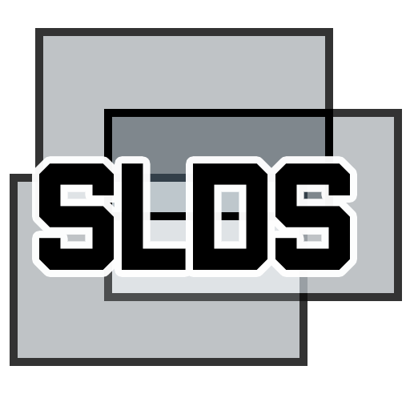

<p align="center"></p>

# KarSlides

**PowerPoint → vMix over NDI®, with live animations, transitions, video and sound, on the same machine as vMix and
without stealing its focus.**

KarSlides keeps Microsoft PowerPoint in the background, runs the slide show on a dedicated (virtual) monitor, captures
it with Windows.Graphics.Capture and sends it to vMix as an NDI source at a constant frame rate. The operator controls
it from a web panel, the speaker from a clicker or a presenter page on a phone or tablet.

NDI® is a registered trademark of Vizrt NDI AB. Learn more about NDI at https://ndi.video/.

*Описание на русском – ниже.*

## Features

- Live slide show in vMix: animations, Morph, transitions, embedded video and its sound (process loopback of
  PowerPoint only).
- Never steals focus from vMix; the show window stays on its own monitor and on top there.
- Constant-rate NDI output that repeats the last frame; never a black frame except on an explicit Black command.
- Watchdog: a hung or crashed PowerPoint is restarted and the show restored at the same slide and click, the output
  frozen on the last frame meanwhile.
- Web operator panel with live preview, thumbnails, next slide, Black/Freeze; presenter page with notes and timer;
  settings page.
- Clicker support (PageDown/PageUp) while vMix has the focus; vMix tally (program/preview).
- English and Russian interface with a per-browser RU | EN switch.
- REST and WebSocket API on port 9180 (vMix ports 8088/8099 are left alone).

## Requirements

- Windows 10 21H2+ or Windows 11, x64.
- Microsoft PowerPoint desktop (Microsoft 365, 2019, 2021, 2024).
- NDI 6 Runtime, installed separately (it comes with NDI Tools, https://ndi.video/tools/). KarSlides does not include
  NDI components.
- A 1920×1080 monitor for the show: a virtual display driver (recommended), an HDMI dummy plug or a separate monitor.

## Download

Portable builds (self-contained, no installer, no .NET needed) are on the
[Releases](../../releases) page. Unpack, run `KarSlides.exe`, open the panel from the tray icon. See `README.md`
inside the archive (`docs/PORTABLE.md` here) for setup and settings.

## Build

```
dotnet build KarSlides.sln -c Debug
dotnet test
dotnet run --project src/KarSlides.App
powershell -File tools/publish-portable.ps1    # artifacts\KarSlides-<version>-win-x64.zip
```

.NET 8 SDK on Windows. NDI is loaded at run time from `NDI_RUNTIME_DIR_V6` (set by the NDI runtime installer).

## Project layout

| Folder | |
|---|---|
| `src/KarSlides.App` | tray application, start-up, settings |
| `src/KarSlides.Core` | slots, watchdog, clicker, preview – logic behind interfaces, covered by tests |
| `src/KarSlides.PowerPoint` | late-bound PowerPoint COM on one STA thread |
| `src/KarSlides.Capture` | Windows.Graphics.Capture of the show monitor |
| `src/KarSlides.Ndi` | own P/Invoke wrapper of the NDI runtime, constant-rate sender |
| `src/KarSlides.Audio` | WASAPI process loopback of PowerPoint, playback device routing |
| `src/KarSlides.Control`, `src/KarSlides.Web` | REST/WebSocket API, web panel (no frameworks) |
| `src/KarSlides.Vmix` | vMix TCP tally and XML API |
| `tests/` | unit tests on fakes |

## License

KarSlides is released under the [MIT License](LICENSE). © 2026 Aleksandr Karabatov.

Third-party components and the additional terms for NDI and Microsoft components that apply to the binary releases
are listed in [THIRD-PARTY-NOTICES.md](THIRD-PARTY-NOTICES.md). KarSlides is not affiliated with or endorsed by
Vizrt NDI AB, Microsoft or StudioCoast (vMix).

---

## KarSlides по-русски

Утилита для Windows: держит PowerPoint в фоне на той же машине, что и vMix, и отдаёт показ в vMix как NDI-источник –
с живыми анимациями, переходами, видео и звуком. vMix не теряет фокус.

- Показ идёт на отдельном (лучше виртуальном) мониторе 1920×1080 и захватывается оттуда.
- Выход NDI всегда с постоянной частотой, чёрный кадр – только по команде Black.
- Сторожевой таймер перезапускает зависший PowerPoint и возвращает показ на тот же слайд и шаг.
- Веб-пульт оператора с живой картинкой, экран спикера с заметками и таймером, настройки в браузере.
- Кликер (PageDown/PageUp) работает, даже когда в фокусе vMix; tally из vMix.

Требования, установка и настройки – в [docs/PORTABLE.md](docs/PORTABLE.md). Готовые сборки – на странице
[Releases](../../releases).

Автор: Aleksandr Karabatov, hellokarabatov@gmail.com. Лицензия – MIT.
